<!--
  Prasanna Poigey | GitHub Profile README
  Original anime-inspired SVG artwork created for this profile.
-->

### EMBEDDED SYSTEMS · AI · IoT · ROBOTICS · WEB

**Turning ideas into real-world solutions.**

[Explore Projects](https://github.com/pojge2005?tab=repositories) &nbsp;•&nbsp; [MiskFlow](https://www.miskflow.tech) &nbsp;•&nbsp; [Connect on GitHub](https://github.com/pojge2005)

---

## 👋 Hey, I'm Prasanna

I'm a developer and hands-on builder who enjoys connecting code with the physical world. My interests span embedded firmware, smart devices, robotics, AI-powered automation, and web applications. I like turning an idea into a prototype, learning from the hardware and software, and improving it one iteration at a time.

- 🔌 **Embedded & IoT:** ESP32, Arduino, FreeRTOS, sensors, I²C, OLED interfaces
- 🤖 **Robotics & AI:** computer vision, object tracking, automation, robotics workflows
- 💻 **Software:** web apps, dashboards, APIs, Android and practical business tools
- 🚀 **Startup:** building products and demos with **[MiskFlow](https://www.miskflow.tech)**
- 📍 **Based in:** Nagpur, Maharashtra, India
- 🌱 **Currently learning:** real-time firmware architecture, OTA updates, and applied AI

> *Build thoughtfully. Test honestly. Document clearly. Keep learning.*

## 🧪 Technology Lab

**Embedded · Systems · Languages**

**Web · Frameworks · Tools**

**Hardware I work with:** ESP32-C3 · ESP32-S3 · SSD1306 OLED · GPIO · I²C · sensors · battery-powered prototypes  
**Engineering focus:** modular firmware · non-blocking state machines · serial debugging · readable documentation · version control

## 🚀 Featured Projects

<table>
<tr>
<td width="50%" valign="top">

### 🔑 [SmartKeychain-V2](https://github.com/pojge2005/SmartKeychain-V2)

An ESP32-C3 mini-device project exploring an OLED interface, button navigation, compact animations, and modular embedded firmware.

**ESP32-C3** · **OLED** · **Embedded UI**

</td>
<td width="50%" valign="top">

### ⚙️ [ESP32-FreeRTOS-IoT](https://github.com/pojge2005/ESP32-FreeRTOS-IoT)

A project for exploring task-based firmware design and real-time IoT patterns with ESP32.

**ESP32** · **FreeRTOS** · **IoT**

</td>
</tr>
<tr>
<td width="50%" valign="top">

### 🔐 [Two-Layer RFID Security](https://github.com/pojge2005/Two-Layer-RFID-Security-System)

An RFID access-control project exploring layered authentication and embedded hardware/software integration.

**RFID** · **Security** · **Embedded**

</td>
<td width="50%" valign="top">

### 🎯 [Real-Time Object Tracking](https://github.com/pojge2005/Real-Time-Object-Tracking-System-Raspberry-Pi-OpenCV-)

A computer-vision project repository for object-tracking experiments with Raspberry Pi and OpenCV.

**OpenCV** · **Raspberry Pi** · **Computer Vision**

</td>
</tr>
</table>

## 📈 GitHub Overview

 

Stats and visitor counts are supplied by external services and may load slowly or be temporarily unavailable. Their values are not hard-coded into this README.

## 🧭 How I Build

**IDEA** → **DEFINE** → **DESIGN** → **PROTOTYPE** → **TEST** → **DOCUMENT** → **IMPROVE** ↺

## 🤝 Let's Create Something Useful

I'm interested in projects involving embedded devices, IoT, robotics, automation, and useful software. I value collaboration, clear communication, and learning by building.

### *Stay curious. Build boldly. Make it real.* ✨

